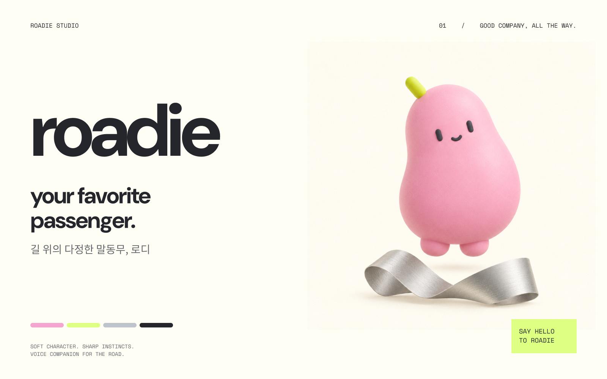
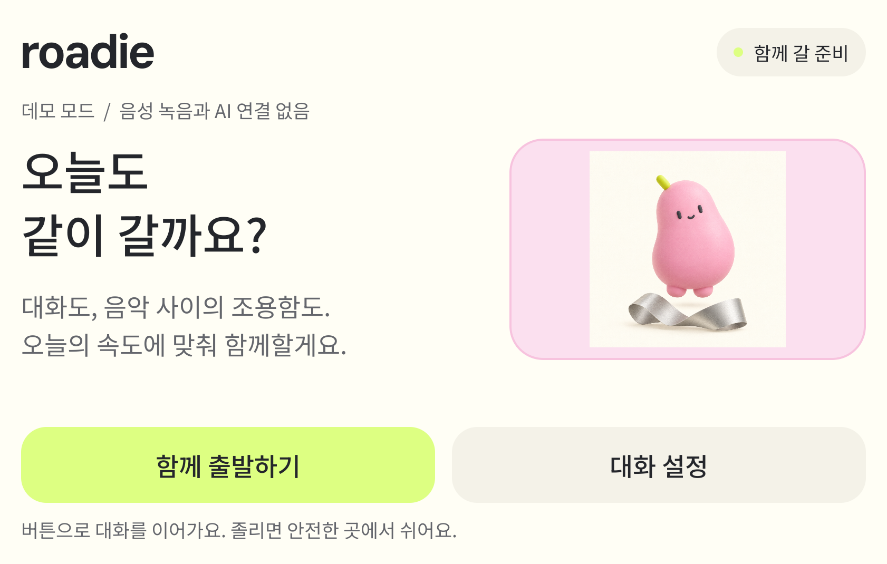
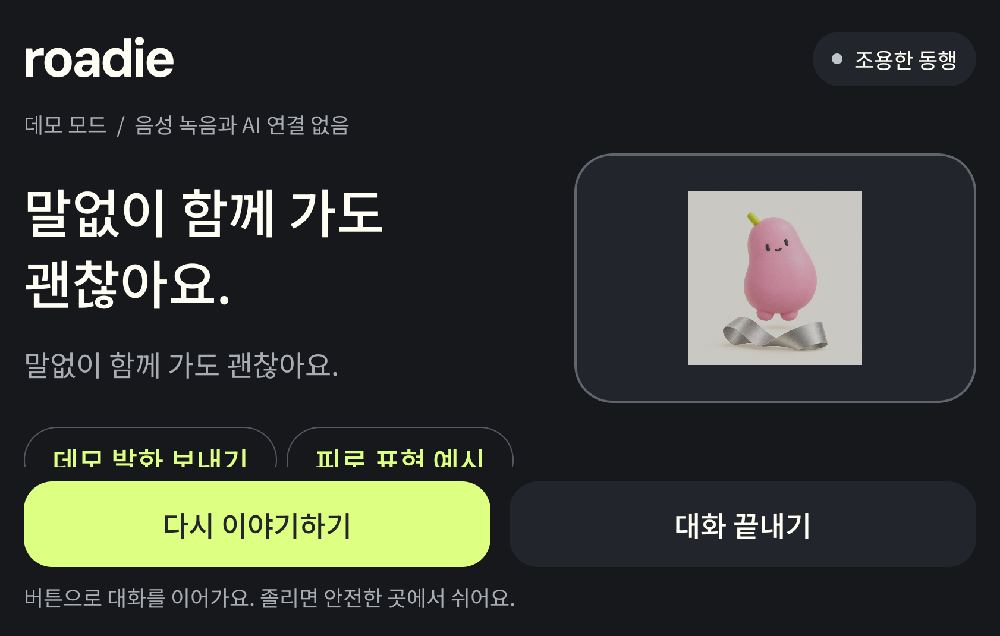
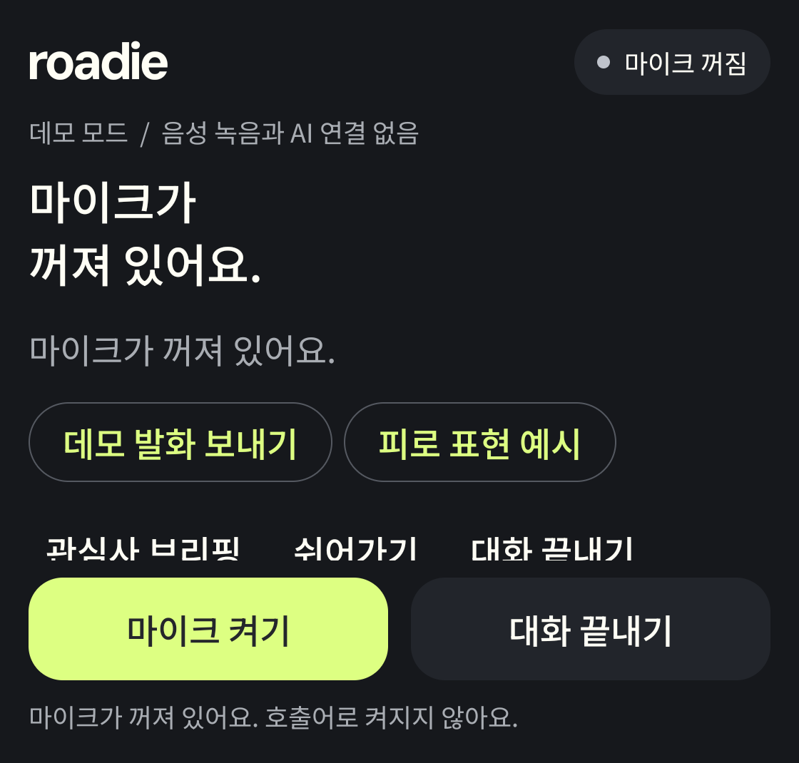

# Roadie 로디

**길 위의 다정한 말동무, 로디**

혼자 오래 운전하는 사람을 위한 Pleos Connect 차량용 AI 음성 동행 앱입니다. 야간 장거리 운전자, 화물 기사, 출퇴근 운전자에게 짧은 대화와 관심사 소식을 전합니다. 중요한 오디오 안내가 나오면 기다리고, 사용자가 조용함을 원하면 말을 멈춥니다.

긴 운전에는 이야기할 상대가 없을 때가 많습니다. 로디는 많은 정보를 읽게 만드는 화면 대신 큰 상태 표시, 큰 버튼과 짧은 음성 응답을 사용합니다. **졸리거나 피곤하면 안전하게 정차하고 쉬어야 합니다. 대화는 휴식을 대신하지 않습니다.** 카메라 기반 졸음 감지는 구현하지 않았습니다.

## 사용 흐름

1. 정차 중 첫 안내를 읽고 관심사, 테마, 서버 연결을 설정합니다. 기억, 먼저 말 걸기, 자동 듣기, 시간 기반 휴식 제안은 각각 선택합니다.
2. `함께 출발하기`를 누르면 Pleos 음성 서비스가 듣습니다. 인식 문장은 서버의 AI로 전달되고 답변을 차량 음성 서비스로 읽습니다.
3. `말 끊고 이야기하기`는 기존 출력과 요청을 취소합니다. `조용히 가기`는 듣기와 출력을 멈추고 동행 상태를 유지합니다. `마이크 끄기`는 별도 상태로 표시합니다.
4. 관심사 브리핑은 실제 RSS 제목을 짧게 읽습니다. 재생, 중단, 다음 소식과 다음 관심사를 선택할 수 있습니다. 자세한 출처는 정차 후 확인합니다.
5. 피로 표현이나 동의한 2시간 동행 기준에 따라 안전한 정차를 제안합니다. 위치 사용에 동의하면 주변 휴게소를 검색하고 선택한 장소를 차량 내비게이션에 전달합니다.

## 구현 범위

| 영역 | 구현 | 경계 |
| --- | --- | --- |
| 시작과 설정 | 첫 실행 안내, 낮과 밤, 관심사, 선택적 기억과 자동 듣기, DataStore 복원 | 실제 CarUxRestrictions 신호로 설정과 상세 출처 제한. 신호가 없으면 잠금 |
| 대화 | 듣기, 생각하기, 말하기, 대기, 오류, 취소와 재시도 상태 머신 | 모델 자격증명이 없으면 명시적인 설정 오류 |
| 음성 | Pleos SpeechToText와 TextToSpeech ON_DEVICE 어댑터, 권한 오류, 취소와 자원 해제 | 호출어, 상시 백그라운드 녹음, 동시에 듣고 말하기 없음 |
| 조용한 동행 | 사용자 요청, 오디오 포커스 중단, 마이크 꺼짐 구분 | 기본값은 안내 종료 후 자동 발화와 자동 녹음 없음 |
| 브리핑 | 한국경제와 NASA RSS, 게시 시각, 출처, 오래됨 표시, 실제 음성 재생 연결 | 기사 본문 요약이 아닌 발행자 헤드라인 발췌. 실시간 교통 정보 아님 |
| 휴식 | 피로 표현 규칙, 선택적 2시간 알림, FusedLocation, Kakao Local, NaviHelper 연결 | 앱 세션 경과 시간이며 실제 운행 시간이나 졸음 감지 아님. 도로 방향 탐색 없음 |
| 화면 | Figma 입체 원본, Compose UI, 크기별 배치, 큰 버튼, 접근성 설명 | 정적인 입체 렌더 이미지 사용. 실시간 3D와 표정 합성 없음 |
| 데모 | 설정에서 명시적으로 전환, 화면에 데모 표시, 예시 발화 버튼 | 녹음, 합성 음성, 실제 AI와 실제 장소 안내를 실행하지 않음 |

플랫폼 실행과 연결 검증의 구체적인 결과는 [검증 기록](docs/verification.md)을 확인하세요. SDK 어댑터 코드가 있다는 것과 실제 차량에서 기능을 검증했다는 것은 별개입니다.

## 디자인과 화면

[최신 Figma 디자인](https://www.figma.com/design/JfTYX9XzesZxlyADnpzlR2/Roadie)을 기준으로 브랜드, Foundations, Components, Vehicle experience를 확인했습니다. 앱은 Compose 텍스트와 버튼으로 구현했습니다. 전체 Figma 스크린샷을 앱 화면으로 사용하지 않습니다.

입체 캐릭터는 원본 `3:116`, README 배너는 브랜드 보드 `6:2`를 로컬 PNG로 보관합니다. 만료되는 Figma 이미지 주소를 런타임에서 요청하지 않습니다. 크림, 핑크, 라임과 크롬 표현은 기존 로디를 유지합니다. 주행 중 반복 애니메이션을 사용하지 않습니다. [노드와 구현 대응](docs/design/implementation.md)

아래는 Pleos 2.1.0에서 네이티브 Compose로 렌더한 화면입니다. 데모 상태를 표시한 계측 캡처이며 실제 AI 응답으로 표시하지 않습니다.

| 출발 | 조용한 동행 |
| --- | --- |
|  |  |



실제 RSS를 연결한 [Pleos 출처 화면](docs/screenshots/pleos-live-sources.png)과 측정한 화면 규격, 플랫폼 제약은 [검증 기록](docs/verification.md)에 기록합니다.

## 기술과 구조

Kotlin 2.1.0, Jetpack Compose, Android Gradle Plugin 8.9.1, Gradle 8.13, JDK 17을 사용합니다. Android `minSdk=28`, `compileSdk=35`, `targetSdk=34`이며 차량용 네이티브 앱입니다. 웹뷰나 휴대폰 전용 앱으로 대체하지 않습니다.

```text
app / Compose + ViewModel
  -> core / 대화 상태, 취소, 휴식, 기억 동의
  -> Pleos / STT, TTS, FusedLocation, NaviHelper
  -> Android Automotive / 주행 제한, 오디오 포커스
  -> HTTPS / 개발용 접근 토큰
       server / 입력 검증, 제한, 취소, 공급자 연결
         -> OpenAI Responses API
         -> 한국경제 RSS, NASA RSS
         -> Kakao Local
```

`core`는 Android에 의존하지 않아 취소와 상태 전이를 JVM에서 검증합니다. `app`은 플랫폼 입출력과 UI를 맡습니다. `server`는 Node.js 20.19 이상에서 실행되며 데이터베이스가 필요하지 않습니다. 요청과 응답 계약은 [API 문서](docs/api.md)에 있습니다.

## 개발 환경 준비

1. JDK 17, Android Studio, Android SDK Platform 35, Build Tools 35.0.0을 설치합니다.
2. `ANDROID_HOME`을 SDK 경로로 지정하거나 Git에서 제외되는 `local.properties`에 `sdk.dir=/your/android/sdk`를 설정합니다.
3. [Pleos 공식 설치 절차](https://document.pleos.ai/docs/connect/guide/getting-started/application-development/setup-connect-sdk-emulator)를 따라 **Pleos Connect Emulator 2.1.0, API 34, ARM64** 이미지를 설치합니다. SDK와 에뮬레이터 이용 조건을 확인하세요. 저장소에 SDK 바이너리나 에뮬레이터 이미지를 재배포하지 않습니다.
4. 공식 Pleos 하드웨어 프로필의 2560 x 1440px, 160dpi, 4GB RAM을 사용하고 Cold Boot로 시작합니다. Quick Boot에서는 차량 HAL 동작이 달라질 수 있습니다. 이번 실행에는 Android Emulator 도구 37.2.13.0을 사용했습니다.
5. Android Studio에서 이 저장소를 그대로 열고 Gradle 동기화를 합니다. Maven 저장소는 `settings.gradle.kts`에 등록되어 있습니다.

실제 마이크 시험은 에뮬레이터 Extended Controls의 Microphone에서 오디오 입력을 활성화해야 합니다. 호스트 OS의 마이크 권한도 확인하세요. [공식 마이크와 그래픽 설정](https://document.pleos.ai/docs/connect/guide/getting-started/application-development/configure-pleos-connect-emulator)

Pleos 의존성은 SpeechToText `3.3.1`, TextToSpeech `3.3.1`, FusedLocation `1.1.3`, NaviHelper `3.0.5`입니다. Vehicle `2.3.2`의 범위도 확인했으나 현재 기능은 주행 제한용 Car API로 충족해 추가하지 않았습니다. 일반 Android 음성 인식 API를 Pleos 마이크 정책의 대체 수단으로 사용하지 않습니다.

공식 서비스 지원표와 개별 음성 SDK 문서의 제공 상태가 일치하지 않는 부분이 있습니다. ON_DEVICE 엔진은 문서상 별도 앱 등록 없이 사용하지만 실제 이미지와 차량에서 서비스가 지원되어야 합니다. HYBRID나 SERVER 모드용 Pleos 앱 등록 정보는 이 구현에서 사용하지 않습니다. 상세 근거는 [플랫폼 메모](docs/platform.md)에 있습니다.

## 서버 실행

저장소 루트에서 실행합니다.

```sh
npm --prefix server ci
node scripts/init-server.mjs
# 로컬 편집기로 server/.env에 필요한 키를 설정
npm --prefix server start
```

초기화 도구는 기존 `.env`를 보존하며 랜덤 접근 토큰을 생성합니다. 모델 키나 토큰을 채팅, Git, APK에 넣지 마세요.

| 환경변수 | 값과 용도 |
| --- | --- |
| `HOST` | 기본 `127.0.0.1`. 개발 서버의 바인딩 주소 |
| `PORT` | 기본 `8787` |
| `ROADIE_ACCESS_TOKEN` | 최소 32자. 앱이 서버에 접근할 때 사용하는 별도 토큰 |
| `OPENAI_API_KEY` | 실제 AI 응답용 서버 키 |
| `OPENAI_MODEL` | 기본 `gpt-4.1-mini`. 계정에서 사용 가능한 Responses 모델 |
| `KAKAO_REST_API_KEY` | 실제 휴게소 검색용 Kakao Local REST API 키 |

[환경변수 예제](server/.env.example)를 제공합니다. 키가 없으면 해당 기능이 `503`을 반환하고 앱에 설정 필요 안내를 표시합니다. 고정 응답을 실제 AI로 숨기지 않습니다. 실제 RSS는 모델 키 없이 사용할 수 있습니다.

서버는 개발용 토큰 인증, IP 제한, 토큰당 분당 20회와 동시 요청 2개 제한을 적용합니다. 공용 서비스 배포에는 TLS, 사용자별 인증, 여러 프로세스에 걸친 요청 제한을 추가해야 합니다. 현재 서버를 인증 없는 공개 AI 프록시로 배포하지 마세요.

## 앱 실행과 연결

```sh
./gradlew :app:assembleDebug
driver_user=$(adb shell am get-current-user | tr -d '\r')
adb install -r --user "$driver_user" app/build/outputs/apk/debug/app-debug.apk
adb shell am start --user "$driver_user" -n ai.roadie.app/.MainActivity
```

Pleos 에뮬레이터에서 정차 상태를 확인한 뒤 안내를 진행합니다. `대화 설정`에서 서버 주소와 `.env`의 `ROADIE_ACCESS_TOKEN`을 입력합니다. **OpenAI 키와 Kakao 키를 앱에 입력하지 않습니다.**

로컬 개발은 아래처럼 포트를 연결하고 debug 앱에 `http://127.0.0.1:8787`을 입력할 수 있습니다.

```sh
adb reverse tcp:8787 tcp:8787
```

debug 앱만 `127.0.0.1`, `localhost`, `10.0.2.2`의 HTTP를 허용합니다. release 앱은 유효한 인증서를 가진 HTTPS 서버 주소가 필요합니다. 접근 토큰은 앱 설정에서 Android Keystore 기반 AES-GCM으로 암호화합니다.

음성 권한이 위험 권한으로 선언된 플랫폼에서는 처음 사용 시 요청합니다. 권한 거부와 마이크 오류는 복구 가능한 상태로 표시하고, 정차 중 차량 앱 권한 화면으로 이동할 수 있습니다. SDK가 지원되지 않으면 지원되지 않는다고 알립니다. 일반 Android 기기에서는 주행 상태가 확인되지 않아 첫 설정이 잠길 수 있습니다.

## 빌드와 테스트

```sh
./gradlew :core:test :app:assembleDebug :app:assembleDebugAndroidTest
# Pleos의 현재 운전자 사용자에서 실행
ANDROID_SERIAL=emulator-5580 bash scripts/test-pleos.sh
./gradlew :app:lintRelease
npm --prefix server test
npm --prefix server run check
# 실행 중인 로컬 서버와 실제 공개 RSS 확인
node --env-file=server/.env scripts/smoke-server.mjs
```

동일 작업 디렉토리에서 Gradle 빌드 여러 개를 동시에 실행하지 마세요. 코어 테스트는 요청 취소와 늦은 응답 무시, 발화 중단, 포커스 복귀, 권한 오류, 네트워크 재시도, 기억 동의와 삭제, 데모 격리, 휴식 제안과 출처 보존을 다룹니다. Android 계측 테스트는 작은 화면의 핵심 버튼, 설정 복원, 저장 암호화와 출처 제한을 다룹니다. 테스트 호스트는 Pleos 셸이 창 크기 변경으로 Activity를 재생성해도 내용을 다시 구성합니다. 서버 테스트는 인증, 제한, 입력 검증, 요청 취소와 RSS 데이터 처리를 다룹니다.

## 서명과 APK

```sh
python3 scripts/init-signing.py
bash scripts/package-release.sh
```

첫 명령은 로컬 release 서명 키와 설정이 없을 때만 생성합니다. `.secrets/roadie-release.jks`와 `keystore.properties`는 Git에서 제외되므로 **두 파일을 안전한 별도 위치에 백업**하세요. 같은 앱 업데이트에는 같은 서명 키가 필요합니다.

패키징 도구는 테스트와 lint, release 빌드, `apksigner verify`를 실행하고 [release APK](apk/Roadie_Roadie_release.apk)와 [SHA-256](apk/SHA256SUMS)을 만듭니다. debug APK의 이름만 바꾸지 않습니다. 공식 파일명 규칙의 팀명은 현재 `Roadie`로 사용하며 실제 제출 팀명이 다르면 제출 전에 바꾸세요. 서명 검증과 설치 결과는 [검증 기록](docs/verification.md)에 기록합니다.

최종 소스 커밋은 `git rev-parse HEAD`, 원격 반영은 `git rev-parse origin/main`으로 확인할 수 있습니다. 이 작업은 실제 접수, 이메일 발송, 공모전 제출을 수행하지 않습니다.

## 개인정보와 기능 제한

- 기억 동의가 없으면 대화는 활성 세션의 최근 6개 메시지만 메모리에 두고 종료 시 지웁니다. 동의 시 이 기기에 최근 3회 대화를 암호화해 보관합니다. 동의를 끄거나 기억 지우기를 누르면 삭제합니다. 데모는 실제 기억을 읽거나 덮어쓰지 않습니다.
- 앱이 백그라운드로 이동하거나 세션이 끝나면 녹음, 출력, 진행 중 요청과 위치 콜백을 정리합니다. 화면 회전은 세션을 보존합니다.
- 서버는 발화, 좌표, 키를 로그에 남기거나 파일에 저장하지 않습니다. OpenAI 요청은 `store:false`지만 제공자의 자체 처리 및 보관 정책은 별도입니다. Pleos 음성 서비스 자체의 개인정보 정책도 적용됩니다.
- 웨이크워드, 상시 녹음, 카메라 기반 졸음 감지, 운행 시간 추적, 실제 차량 검증을 구현 또는 확인한 것으로 표시하지 않습니다.
- 기본값은 답변 후 마이크를 다시 켜지 않습니다. 자동 듣기 동의가 있어도 브리핑, 휴식 제안, 명시적인 조용함 또는 마이크 끄기 뒤에는 자동으로 이어 듣지 않습니다.
- 오디오 포커스 상실은 중요한 오디오에 양보하는 신호입니다. 이를 모두 내비 안내 이벤트라고 단정하지 않습니다. 경로 탐색 성공도 안내 음성 재생과 다른 이벤트입니다.
- Kakao의 주변 장소는 직선거리 기준이며 현재 도로 방향과 연결 여부를 보장하지 않습니다. 차량 내비에서 경로를 확인해야 합니다.

## 출처와 라이선스

브랜드와 캐릭터는 사용자가 제공한 [Roadie Figma](https://www.figma.com/design/JfTYX9XzesZxlyADnpzlR2/Roadie) 원본입니다. 별도의 오픈 라이선스로 재허가하지 않습니다.

DM Sans, Noto Sans KR, Space Mono는 [Google Fonts 저장소](https://github.com/google/fonts)의 SIL Open Font License 1.1 배포본을 로컬에 포함했습니다. [원문 라이선스](app/src/main/assets/licenses/)를 함께 제공합니다. [DM Sans](https://github.com/google/fonts/tree/main/ofl/dmsans), [Noto Sans KR](https://github.com/google/fonts/tree/main/ofl/notosanskr), [Space Mono](https://github.com/google/fonts/tree/main/ofl/spacemono)

Kotlin, kotlinx.coroutines, AndroidX, Jetpack Compose, DataStore, OkHttp와 Gradle은 Apache License 2.0, fast-xml-parser는 MIT, Node.js는 MIT 및 포함된 구성요소의 라이선스를 따릅니다. Pleos SDK는 42dot의 SDK 이용 조건을 따릅니다. RSS 콘텐츠와 Kakao 장소 데이터의 권리는 각 제공자에게 있으며 전체 기사 본문을 재배포하지 않습니다.

공식 자료는 2026-11-16에 확인했습니다. [공모전 제출 안내](https://appdevchallenge.auto-hmg.io/guide/submission), [개발 환경](https://appdevchallenge.auto-hmg.io/guide/development), [Pleos 문서](https://document.pleos.ai/), [OpenAI Responses API](https://platform.openai.com/docs/api-reference/responses/create), [Kakao Local API](https://developers.kakao.com/docs/latest/ko/local/dev-guide), [한국경제 RSS](https://www.hankyung.com/feed/it), [NASA RSS](https://www.nasa.gov/feed/)
